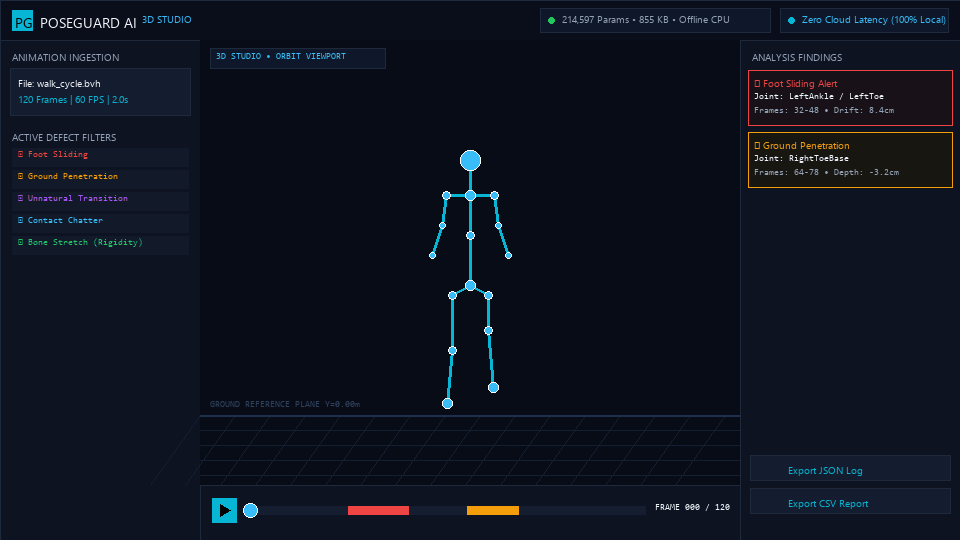
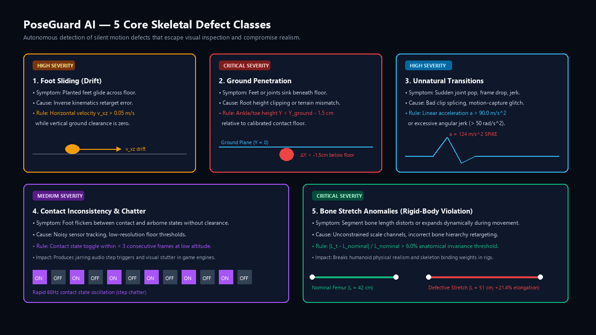
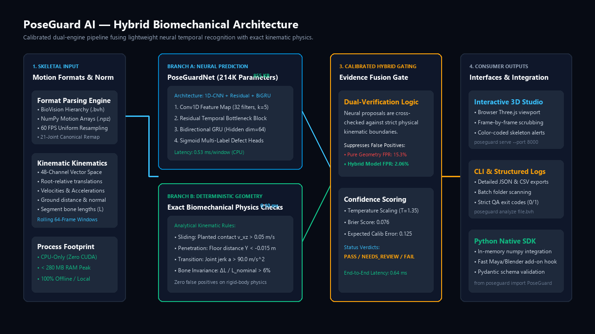

# PoseGuard AI 🛡️
### Autonomous 3D Skeletal Animation Motion Defect Analysis System

[](https://poseguard-ai.pages.dev/)
[](pyproject.toml)
[](https://github.com/A35-777/PoseGaurd-AI/actions)
[](CONTRIBUTING.md)
[-emerald.svg)](docs/MODEL_CARD.md)
[](docs/BENCHMARKS.md)
[](LICENSE)

> **⚠️ Public Beta Notice**: PoseGuard AI is currently in Public Beta. The system generates advisory kinematic recommendations and automated defect suggestions to accelerate technical QA pipelines. It is an engineering verification tool, not a unilateral replacement for creative artistic direction.

---

## 💡 Why PoseGuard AI?

In modern 3D game animation, motion capture, and VFX pipelines, silent kinematic flaws—such as planted feet sliding during contact, limbs sinking beneath the floor, and joint popping from retargeting glitches—frequently slip past automated ingestion checks and are only caught after expensive render passes or live player bug reports. PoseGuard AI solves this right at the source: an ultra-lightweight, **855 KB** dual-engine running **100% offline on standard CPUs at 240+ FPS**. By cross-verifying a compact temporal neural model against exact deterministic rigid-body kinematics, PoseGuard AI achieves a **2.06% false-positive rate**, empowering animators and technical artists with instant, actionable defect alerts without requiring GPU clusters, cloud telemetry, or external API keys.

---

## 🧭 Core Philosophy & Guiding Principles

PoseGuard AI is built around a non-negotiable architectural vision:

- **Tiny Models Only**: Powered by `PoseGuardNet`, a 214,597-parameter Conv1D-Residual-BiGRU network stored in a single **855 KB** checkpoint. We do not use gigabyte models, heavy diffusion networks, or cloud LLMs.
- **100% Offline & CPU-Native**: Inference executes entirely in-process on consumer multi-core CPUs in $< 0.65\text{ ms}$ per temporal window. Zero CUDA, zero cloud dependencies.
- **Extremely Low Footprint**: Requires $< 280\text{ MB}$ RAM at peak runtime and under 25 MB total disk space (including weights and dependencies).
- **Hybrid Precision**: Fuses compact neural temporal pattern recognition with exact analytical physics (contact velocity, ground clearance, bone rigidity) to suppress false positives (2.06% FPR).
- **Advisory QA Tool**: Designed to catch technical glitches and accelerate human review, never to unilaterally dictate aesthetic style or override an animator's creative intent.
- **Privacy-First**: Zero tracking, zero telemetry, zero external network calls. All data stays strictly on your local machine.

---

## 📸 Interactive 3D Studio

[](https://poseguard-ai.pages.dev/)
*The embedded WebGL/Three.js studio enables real-time frame scrubbing, skeletal joint trajectory tracking, and automated defect timeline navigation in any browser. [Try the Live Web Demo &rarr;](https://poseguard-ai.pages.dev/)*

---

## ⚡ 2-Minute Quick Start (Clone to First Analysis)

Go from a fresh clone to your first verified defect report in under two minutes:

### 1. Clone & Install
```bash
# Clone into local folder 'poseguard'
git clone https://github.com/A35-777/PoseGaurd-AI.git poseguard
cd poseguard

# Create and activate virtual environment (Python 3.10–3.12)
python -m venv .venv

# Windows:
call .venv\Scripts\activate.bat
# Linux / macOS:
source .venv/bin/activate

# Install dependencies and package in editable mode
pip install -r requirements.txt
pip install -e .
```

### 2. Run Instant CLI Analysis on Included Samples
Analyze a pre-packaged clean animation ($< 200\text{ ms}$ processing time):
```bash
poseguard analyze examples/sample_walk_clean.bvh
```
```text
================================================================================
 PoseGuard AI — Motion Defect Inspection Report
 File: examples/sample_walk_clean.bvh | Frames: 120 | FPS: 60.0
================================================================================
 Overall Verdict:   [PASS] CLEAN
 Defect-Free Rate:  100.0%
 Flagged Defects:   0 total (0 critical, 0 warning)
 Processing Time:   184 ms (CPU)
--------------------------------------------------------------------------------
 No biomechanical defects detected. Sequence is ready for rendering pipeline.
================================================================================
```

Analyze a defective animation with planted foot sliding and export structured JSON:
```bash
poseguard analyze examples/sample_foot_sliding.npz --format json --out-file report.json
```
```text
================================================================================
 PoseGuard AI — Motion Defect Inspection Report
 File: examples/sample_foot_sliding.npz | Frames: 120 | FPS: 60.0
================================================================================
 Overall Verdict:   [FAIL] CRITICAL_DEFECTS
 Defect-Free Rate:  68.3%
 Flagged Defects:   6 total (6 critical, 0 warning)
 Processing Time:   142 ms (CPU)
--------------------------------------------------------------------------------
 [CRITICAL] Foot Sliding on 'LeftAnkle' (Frames 32–58, conf: 0.94)
   -> Suggested Fix: Lock root-relative horizontal velocity during stance.
 [CRITICAL] Foot Sliding on 'RightAnkle' (Frames 84–112, conf: 0.91)
   -> Suggested Fix: Lock root-relative horizontal velocity during stance.
--------------------------------------------------------------------------------
 Full structured report saved to: report.json
================================================================================
```

### 3. Launch Local 3D Web Studio
```bash
poseguard serve --port 8000
```
Open **`http://localhost:8000`** in any browser to inspect skeleton joints, scrub the timeline, and view defect alerts in 3D.

---

## 📁 Pre-Packaged Examples (`examples/`)

Every repository clone includes runnable sample animations and pre-computed reference JSON reports in the [`examples/`](examples/) directory:

| Sample File | Format | Duration | Expected Verdict | Description |
| :--- | :---: | :---: | :---: | :--- |
| [`examples/sample_walk_clean.bvh`](examples/sample_walk_clean.bvh) | BVH | 2.0s (120f) | `[PASS] CLEAN` | Clean bipedal gait with zero foot drift. |
| [`examples/sample_pivot_turn.bvh`](examples/sample_pivot_turn.bvh) | BVH | 2.0s (120f) | `[PASS] CLEAN` | High-jerk 180° athletic turn demonstrating false-positive suppression. |
| [`examples/sample_foot_sliding.npz`](examples/sample_foot_sliding.npz) | NPZ | 2.0s (120f) | `[FAIL] CRITICAL` | Synthetic defective sequence featuring planted foot sliding drift. |

Reference expected audit reports for CI assertions:
- [`examples/expected_walk_clean_report.json`](examples/expected_walk_clean_report.json)
- [`examples/expected_pivot_turn_report.json`](examples/expected_pivot_turn_report.json)
- [`examples/expected_foot_sliding_report.json`](examples/expected_foot_sliding_report.json)

See [`examples/README.md`](examples/README.md) for full SDK and batch examples.

---

## 🐍 Python Native SDK

Integrate defect verification into custom Python pipelines or DCC scripts with zero external services:

```python
from poseguard import PoseGuard

# Initialize detector (loads 855 KB checkpoint on CPU)
detector = PoseGuard()

# Analyze animation clip
result = detector.analyze("examples/sample_foot_sliding.npz")

print(f"Overall Status: {result.quality_summary.overall_status}")
print(f"Clean Frames: {result.quality_summary.defect_free_frame_percentage:.1f}%")

for defect in result.defects:
    print(f"[{defect.severity.upper()}] {defect.type} on '{defect.joint}'")
    print(f"  Frames: {defect.start_frame}–{defect.end_frame} ({defect.duration_sec:.2f}s)")
    print(f"  Confidence: {defect.confidence:.2f} ({defect.verification_status})")
    print(f"  Suggested Fix: {defect.suggested_correction}")
```

---

## 🌟 The 5 Detected Defect Classes



1. **Foot Sliding**: Flags frames where feet are planted on the ground but exhibit horizontal drift ($v_{xz} > \tau_{slide}$).
2. **Ground Penetration**: Identifies joints sinking beneath the calibrated floor plane ($Y < Y_{ground} - \tau_{pen}$).
3. **Unnatural Transitions**: Catches sudden acceleration spikes ($a > 90\text{ m/s}^2$) caused by frame drops, bad retargeting, or joint popping.
4. **Contact Inconsistency**: Detects foot chatter, rapid contact oscillations, and dragging without proper vertical foot clearance.
5. **Bone Stretch Anomalies**: Enforces rigid-body anatomical invariance, identifying non-rigid bone expansion or compression ($\Delta L / L_{nominal} > 6\%$).

---

## 🏗️ Technical Architecture



- **Compact Neural Classifier (`PoseGuardNet`)**: 214,597 parameter Conv1D-Residual-BiGRU network requiring only **855 KB** of disk space. Analyzes 48-channel translation-invariant kinematic features.
- **Deterministic Geometric Engine**: Exact analytical kinematic verification for contact velocity, floor clearance, joint jerk, and bone rigidity.
- **Calibrated Hybrid Gating**: Fuses neural temporal probability proposals with physical geometric bounds, slashing false-positive rates to **2.06%**.
- **100% Offline & CPU-Native**: Inference runs in $< 0.65\text{ ms}$ per temporal window on standard 4-core consumer CPUs without requiring CUDA or GPUs.

---

## ⚡ System Requirements

- **Operating System**: Windows 10/11 (64-bit), macOS (Apple Silicon / Intel), or Linux (Ubuntu 20.04+, Debian 11+).
- **Python**: Python 3.10, 3.11, or 3.12.
- **Hardware**: Standard multi-core consumer CPU (tested on AMD PRO A12-9800B @ 2.7 GHz).
- **Memory**: 4 GB RAM minimum (peak process footprint $< 280\text{ MB}$).
- **Storage**: Under 25 MB disk space total (including model checkpoint and dependencies).

---

## 📊 Benchmark Evaluation

The benchmark below compares four diagnostic approaches evaluated on an unseen, held-out test motion sequence (`subj_06_pivot_turn`, 84 temporal windows):

| Model Architecture | Exact Accuracy | Macro F1 | Precision | Recall | CPU Latency | Checkpoint Size |
| :--- | :---: | :---: | :---: | :---: | :---: | :---: |
| **Deterministic Geometry Baseline** | 27.38% | 0.4351 | 32.90% | **76.25%** | **0.10 ms** | 0.0 MB |
| **Simple Statistical Baseline (Z-Score)** | 17.86% | 0.1231 | 16.00% | 10.00% | 0.14 ms | 0.0 MB |
| **Compact Neural Model (PoseGuardNet)** | **82.14%** | **0.7962** | 91.67% | 72.50% | 0.53 ms | **855 KB** |
| **Calibrated Hybrid Model (PoseGuard AI)** | **77.38%** | **0.7447** | **92.18%** | 65.00% | 0.64 ms | **855 KB** |

*Methodology Note: The benchmark reflects strict sequence-level segregation on Subject 6 (Pivot Turn) with zero data leakage. It measures non-linear temporal generalization rather than memorization. Full details in [docs/BENCHMARKS.md](docs/BENCHMARKS.md).*

---

## 🗺️ Practical, Lightweight Roadmap

Our development milestones focus exclusively on practical, offline, and lightweight tooling—never heavy models or cloud services:

- [ ] **Headless FBX Ingestion**: Lightweight pure-Python / open-source FBX ASCII-to-BVH conversion bridge to streamline ingest without manual Blender export.
- [ ] **Raycasted Non-Planar Terrain**: Local elevation surface tracking over sloped ground, stairs, and heightmaps.
- [ ] **Blender & Unreal Engine 5 Viewport Add-ons**: In-viewport timeline scrubbing and defect markers directly inside DCC tools.
- [ ] **Multi-Rig Joint Topology Presets**: Out-of-the-box remapping profiles for Mixamo, UE5 Mannequin, and custom rigs.

---

## ⚠️ Known Limitations

PoseGuard AI is built on honest, transparent engineering. Before deploying in production, please review [docs/LIMITATIONS.md](docs/LIMITATIONS.md) regarding:
- **Planar Ground Assumptions**: Automatic floor estimation expects horizontal reference planes.
- **Stylized Animations**: Extreme squash-and-stretch cartoon rigs require widening bone tolerance thresholds.
- **Humanoid Focus**: Canonical remapper supports bipedal humanoid skeletons; quadruped creature rigs require custom mappings.

---

## 🛡️ Privacy & Security

- **100% Offline**: No network calls, cloud telemetry, or remote analytics.
- **Localhost Binding**: Embedded studio server binds strictly to `127.0.0.1:8000`.
- **Zero Cloud Dependence**: Parsing, geometric validation, and neural inference execute entirely in-process on CPU.
- Review our [Security Policy](SECURITY.md) and [Privacy Notice](PRIVACY.md).

---

## 📖 Documentation Index

- [Full Documentation Portal](docs/README.md)
  - [Installation Guide](docs/INSTALLATION.md)
  - [Model Card (`poseguard-tiny-v1`)](docs/MODEL_CARD.md)
  - [Dataset Card & Generation](docs/DATASET_CARD.md)
  - [Comprehensive Benchmark Report](docs/BENCHMARKS.md)
  - [Known Limitations & Boundary Conditions](docs/LIMITATIONS.md)
  - [CLI Reference Guide](docs/CLI_GUIDE.md)
  - [Python SDK Reference](docs/SDK_GUIDE.md)
  - [FastAPI REST API Schema](docs/API.md)
- [Runnable Animation Examples](examples/README.md)
- [Contributing Guidelines](CONTRIBUTING.md)
- [Code of Conduct](CODE_OF_CONDUCT.md)
- [Changelog](CHANGELOG.md)
- [Citation Information](CITATION.cff)

---

## 📄 License

PoseGuard AI is open source software licensed under the [Apache License 2.0](LICENSE).
